# MaintainIQ: Plant Maintenance & Energy Tracking Portal

A full-stack web app for a manufacturing plant: operators raise maintenance requests, log machine stoppages and submit energy readings; supervisors assign and close work orders, manage users and read reports generated live from MySQL.

**Stack:** HTML5 · CSS3 (Grid, Flexbox) · vanilla JavaScript (ES modules, Fetch, async/await) · Node.js · Express · MySQL 8 · JWT · bcrypt · Morgan · Helmet · Jest · Supertest · Postman · GitHub Actions

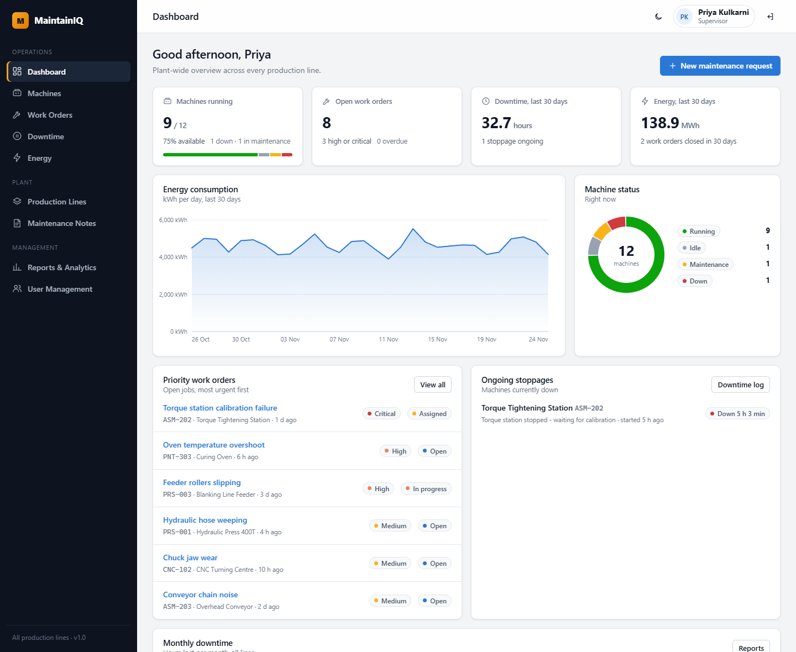

> **Live demo:** not deployed yet (see [Deployment](#deployment)).

---

## Contents
[Problem](#problem) · [Features](#features) · [Architecture](#architecture) · [Database](#database) · [Getting started](#getting-started) · [Environment variables](#environment-variables) · [API](#api) · [Testing](#testing) · [Debugging notes](#debugging-notes) · [Screenshots](#screenshots) · [Deployment](#deployment) · [Future improvements](#future-improvements)

## Problem

On many shop floors, breakdowns are reported verbally, downtime is noted on paper and energy meter readings end up in a spreadsheet nobody joins with the maintenance log. Supervisors cannot answer simple questions: *which machines lose the most time, which line uses the most energy, who has too many open jobs?*

MaintainIQ puts the three records (work orders, downtime and energy) in one normalised database, with role-based access, so those questions become SQL queries.

## Features

| Area | Operator | Supervisor |
|---|---|---|
| Machines | View machines on **their line**, change status | View all, add, edit, delete (blocked while history exists) |
| Work orders | Raise maintenance requests, start jobs assigned to them, add notes | Create, assign, edit, close (with resolution note), delete |
| Downtime | Log stoppages (ongoing or finished), end their own | Everything, delete |
| Energy | Submit one reading per machine per day | Everything, delete wrong readings |
| Reports | Dashboard KPIs for their line | Six SQL reports + CSV export |
| Users | Self-register as operator | Create users, change roles and lines, deactivate |

- **Security:** bcrypt password hashing, JWT auth, `401` when not logged in and `403` when the role or line is wrong, user re-checked on every request (deactivation is immediate), Helmet with a strict Content-Security-Policy, request size limit, parameterised SQL only, unknown body fields dropped, no stack traces in production responses.
- **Validation:** a small validator middleware returns `400` with per-field messages, which the UI shows next to the matching input.
- **UI:** 10 screens, dark/light theme, responsive down to phone width, loading skeletons, empty and error states, hand-built SVG charts with hover tooltips (no chart library).

## Architecture

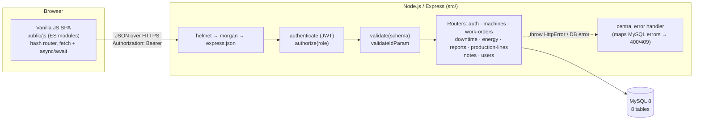

```
maintainiq/
├── db/                 schema.sql, seed.sql
├── docs/               DATABASE.md (ER diagram), API.md, screenshots/
├── postman/            MaintainIQ.postman_collection.json (39 requests with tests)
├── public/             index.html, css/styles.css, js/ (api, ui, charts, main, views/*)
├── scripts/            db-setup.js, screenshots.js
├── src/
│   ├── app.js          Express app (middleware order, routers, static files)
│   ├── server.js       starts the server, graceful shutdown
│   ├── config/         env.js (validated config), db.js (mysql2 pool)
│   ├── middleware/     auth.js, validate.js, errorHandler.js
│   ├── routes/         one router per resource
│   └── utils/          httpError, asyncHandler, scope (operator line filter)
└── tests/              6 Jest + Supertest suites against a real MySQL test DB
```

**Request flow, e.g. an operator closing a work order:** `authenticate` verifies the JWT and loads the user → `authorize('supervisor')` rejects with **403** → the central error handler formats `{ "error": { "code": "FORBIDDEN", ... } }`.

## Database

Eight normalised tables: `roles`, `users`, `production_lines`, `machines`, `work_orders`, `downtime_logs`, `energy_readings`, `maintenance_notes`. They have 13 foreign keys, 5 unique constraints, 4 CHECK constraints and 10 secondary indexes.

Full ER diagram, design decisions and index list: **[docs/DATABASE.md](docs/DATABASE.md)**.

Example: machines with above-average downtime (subquery + `HAVING`):

```sql
SELECT m.asset_tag, m.name,
       SUM(TIMESTAMPDIFF(MINUTE, d.started_at, COALESCE(d.ended_at, NOW()))) AS downtime_minutes
  FROM machines m
  JOIN downtime_logs d ON d.machine_id = m.id
 GROUP BY m.id, m.asset_tag, m.name
HAVING downtime_minutes > (
       SELECT AVG(t.total)
         FROM (SELECT SUM(TIMESTAMPDIFF(MINUTE, started_at, COALESCE(ended_at, NOW()))) AS total
                 FROM downtime_logs GROUP BY machine_id) AS t);
```

## Getting started

Requirements: Node.js 18+ (developed on 22) and MySQL 8.

```bash
git clone https://github.com/Jackhaider/maintainiq.git
cd maintainiq
npm install
cp .env.example .env            # then fill in the values

# create the databases and a user (once, as MySQL root)
mysql -u root -p -e "CREATE DATABASE maintainiq; CREATE DATABASE maintainiq_test;
  CREATE USER 'maintainiq'@'localhost' IDENTIFIED BY 'your-password';
  GRANT ALL ON maintainiq.* TO 'maintainiq'@'localhost';
  GRANT ALL ON maintainiq_test.* TO 'maintainiq'@'localhost';"

npm run db:setup                # creates the 8 tables and loads demo data
npm run dev                     # http://localhost:3000
```

Demo logins (password = your `SEED_PASSWORD`): `supervisor@maintainiq.demo` (all lines) and `operator@maintainiq.demo` (Press Shop only).

## Environment variables

| Variable | Purpose |
|---|---|
| `PORT` | HTTP port (default 3000) |
| `NODE_ENV` | `development`, `test` or `production` |
| `DB_HOST`, `DB_PORT`, `DB_USER`, `DB_PASSWORD`, `DB_NAME` | MySQL connection |
| `DB_NAME_TEST` | Separate database used by the tests (they reset it) |
| `DB_SSL` | `true` for hosted MySQL that requires TLS |
| `JWT_SECRET` | Token signing key: at least 32 random characters in production |
| `JWT_EXPIRES_IN` | Token lifetime, e.g. `8h` |
| `SEED_PASSWORD` | Password given to the demo users by `npm run db:setup` |
| `CORS_ORIGINS` | Only needed if the frontend is hosted on another domain |

`.env` is git-ignored; only `.env.example` (no real values) is committed.

## API

47 endpoints: 45 across 9 routers, plus `/api/health` and the public production-line list. Full reference with status codes: **[docs/API.md](docs/API.md)**.

```http
POST /api/auth/login              → { data: { token, user } }
GET  /api/machines?status=down    → { data: [...], meta: { count } }
POST /api/work-orders/:id/close   → supervisor only, else 403
GET  /api/reports/monthly-energy  → GROUP BY line, month
```

## Testing

The tests use **Jest + Supertest** against a **real MySQL test database**, rebuilt from `schema.sql` + `seed.sql` before each suite. They are not mocked, so SQL, constraints and transactions are exercised too.

```bash
npm test                 # all suites
npm run test:coverage    # with coverage report
```

Latest local run (MySQL 8.0.45, Node 22):

```
Test Suites: 6 passed, 6 total
Tests:       112 passed, 112 total
Coverage:    87.66% statements · 74.39% branches · 89.47% functions · 91.49% lines
```

| Suite | Covers |
|---|---|
| `auth.test.js` | register, bcrypt storage, duplicate email, validation, login, wrong password, JWT forgery/expiry, deactivated users |
| `machines.test.js` | CRUD, operator line scoping (403), filters, invalid ids (400), 404, FK and unique violations |
| `workOrders.test.js` | full lifecycle (request → assign → start → note → close), role checks, 409 state errors, cascade delete |
| `downtimeEnergy.test.js` | duration maths, date validation, ongoing stoppages, unique daily reading, GROUP BY totals |
| `reports.test.js` | 401/403/200 for every report, and **each report checked against independent SQL** |
| `usersLinesApp.test.js` | user management, role changes, health check, JSON 404, security headers, 413 body limit |

CI ([`.github/workflows/ci.yml`](.github/workflows/ci.yml)) runs the same suite against a MySQL 8 service container on every push and pull request.

**Postman:** import `postman/MaintainIQ.postman_collection.json`, set `baseUrl` and `password`, then run the collection. All 39 requests and their status-code tests passed against a local server.

## Debugging notes

Real problems found while building this, and how they were tracked down:

1. **Blank page after login (CSS Grid).** The sidebar rendered but the content area was empty. In DevTools, the Elements panel showed `.main` placed in a *second grid row* below the viewport: the mobile "scrim" `<div>` was taking the second column of `.app`'s two-column grid. Fix: `.scrim { display: none }` except when the mobile menu is open.
2. **Console error `<rect> attribute width: A negative value is not valid`.** It appeared only on the Reports page. The charts were drawing while their card was still being laid out (width ≈ 0), so `width - margins` went negative. Fix: the ResizeObserver callback skips widths under 160 px and draws once the real width is known.
3. **Operator menu around a supervisor's data.** After signing in as a different user in another tab, the old tab kept its shell (name, menu) while new API calls used the new token from `localStorage`. Fix: listen for the `storage` event and reload when the token changes.
4. **A test assumption that didn't hold.** `reports.test.js` expected at least one machine with no work orders to prove the `LEFT JOIN`, but the seed gives every machine one. The test now inserts a fresh machine and checks that it appears with zeros, which tests the JOIN itself rather than the seed data.
5. **Downtime outlier wasn't an outlier.** The seed meant to make `ASM-202` unreliable, but the above-average report (correctly) didn't list it. Counting rows per machine with `GROUP BY machine_id` showed it only had 8 events. The seed formula was fixed and the report test now asserts both machines.

Tools: **Morgan** logs every request (`dev` format locally, `combined` in production); unexpected errors are logged server-side with method and URL; `npm run debug` starts Node with `--inspect` for Chrome DevTools (`chrome://inspect`) breakpoints.

## Screenshots

| | |
|---|---|
| 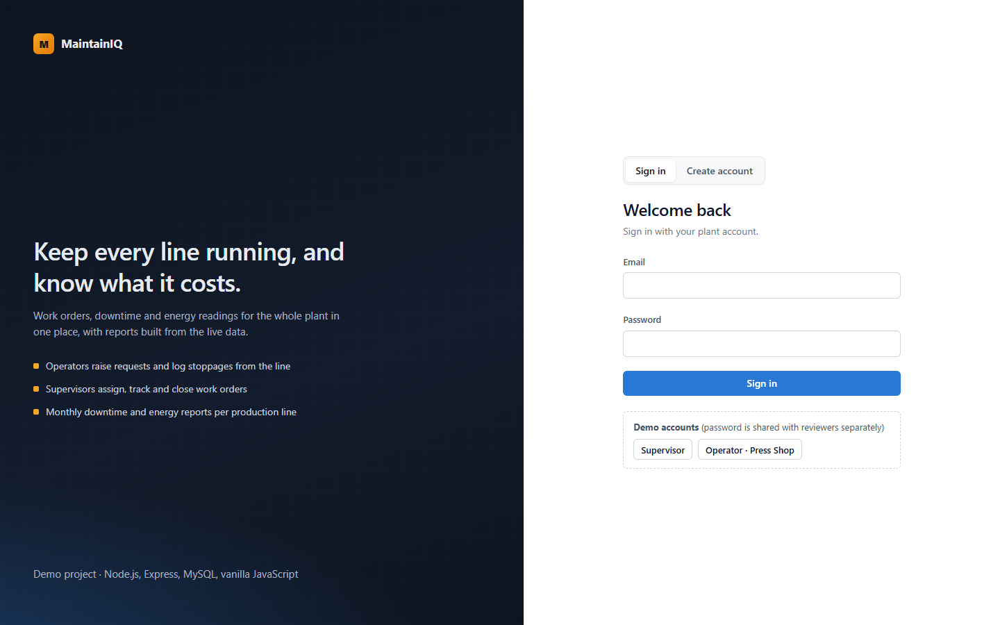 Login / sign-up | 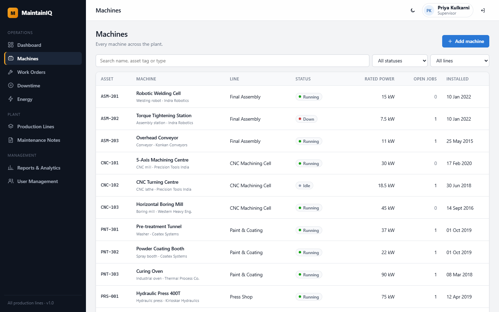 Machines |
| 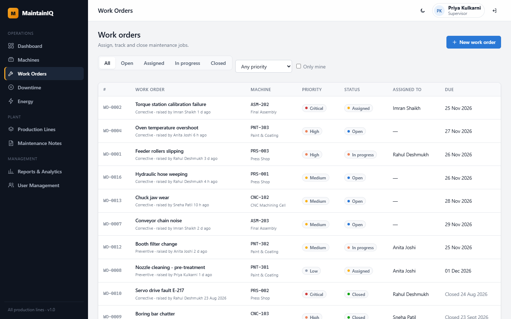 Work orders | 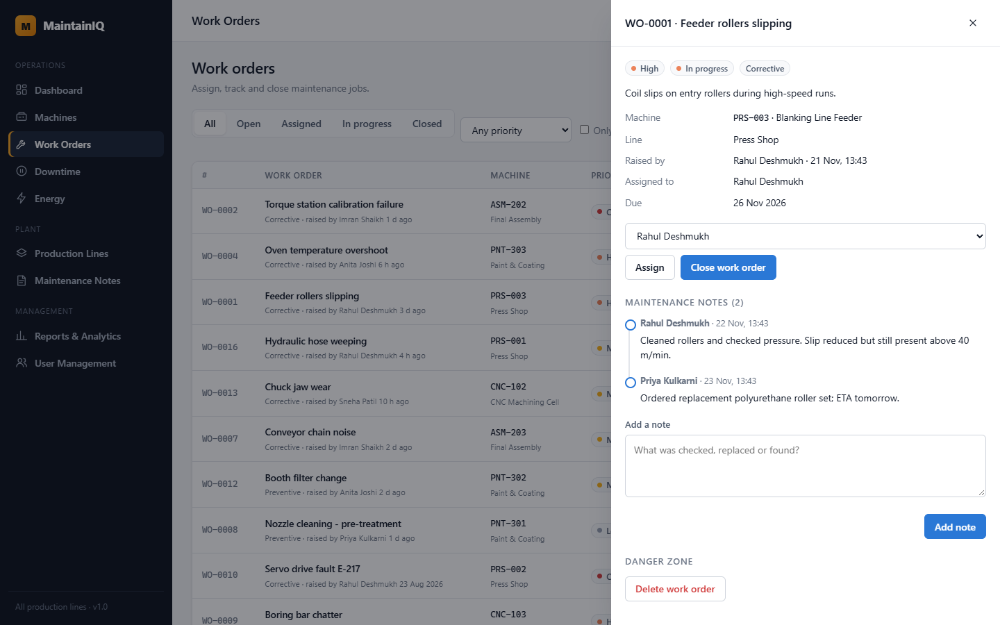 Work order with notes timeline |
| 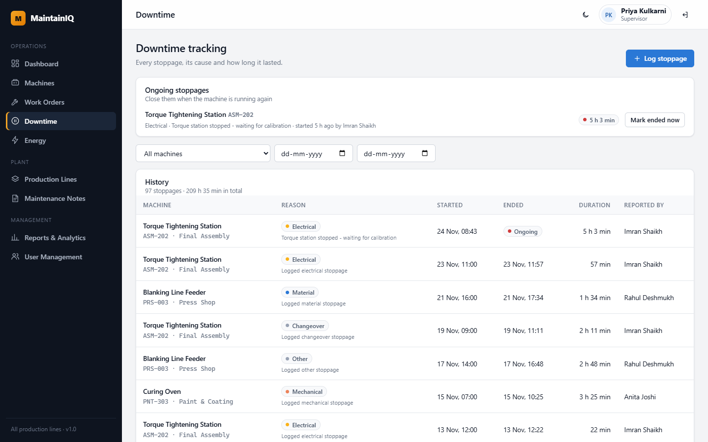 Downtime | 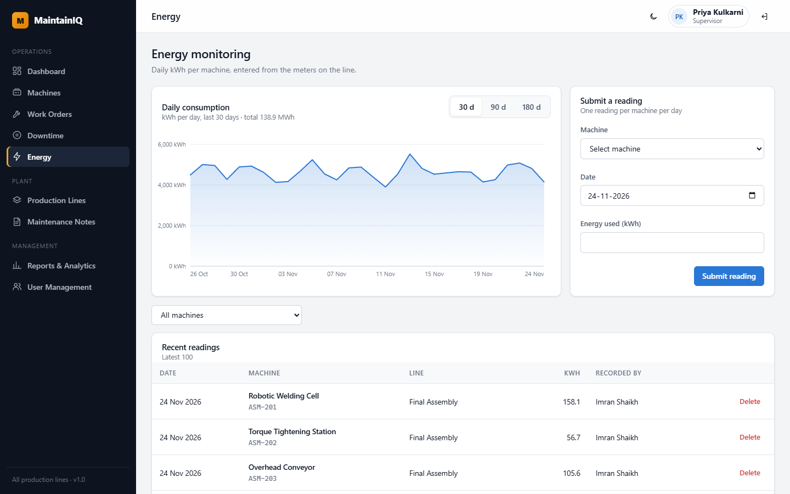 Energy monitoring |
| 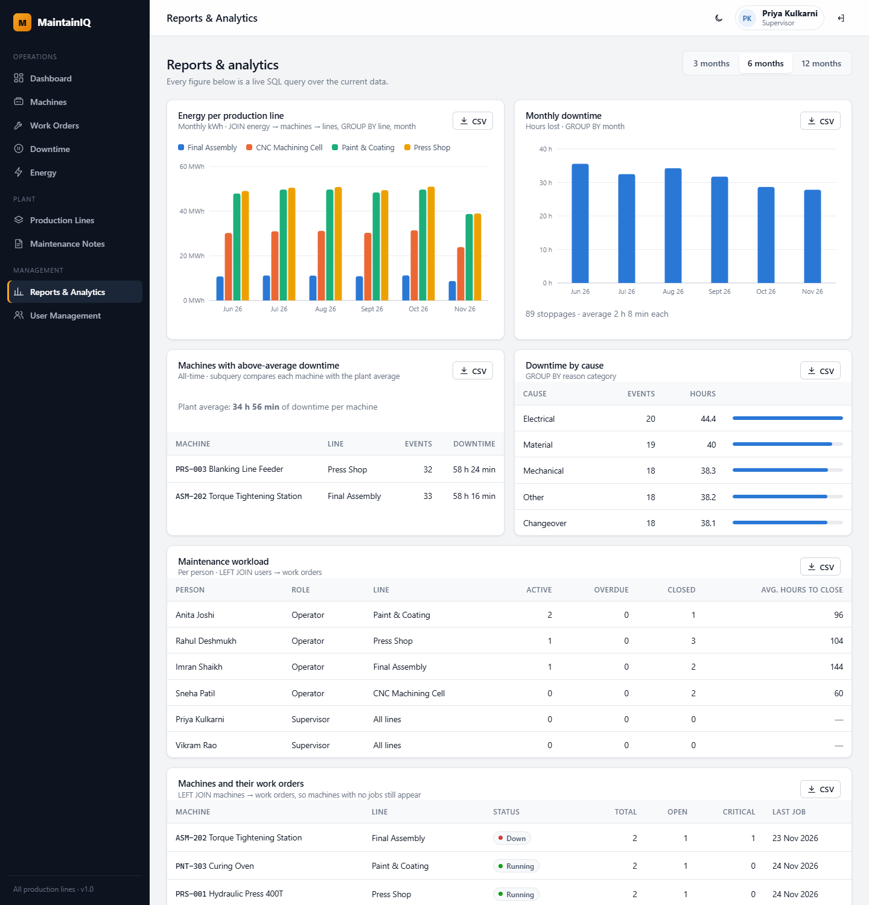 Reports | 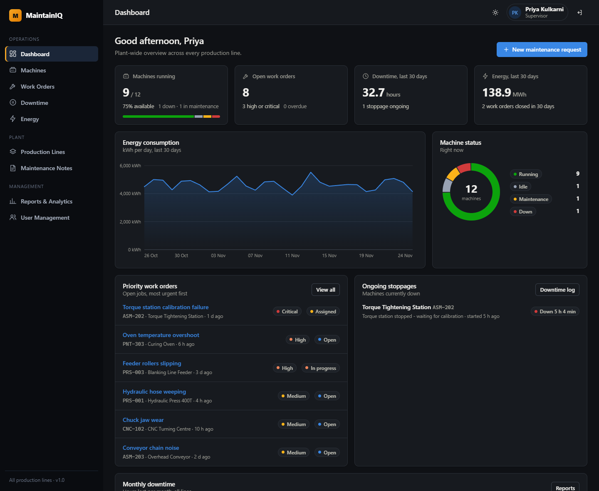 Dark mode |
| 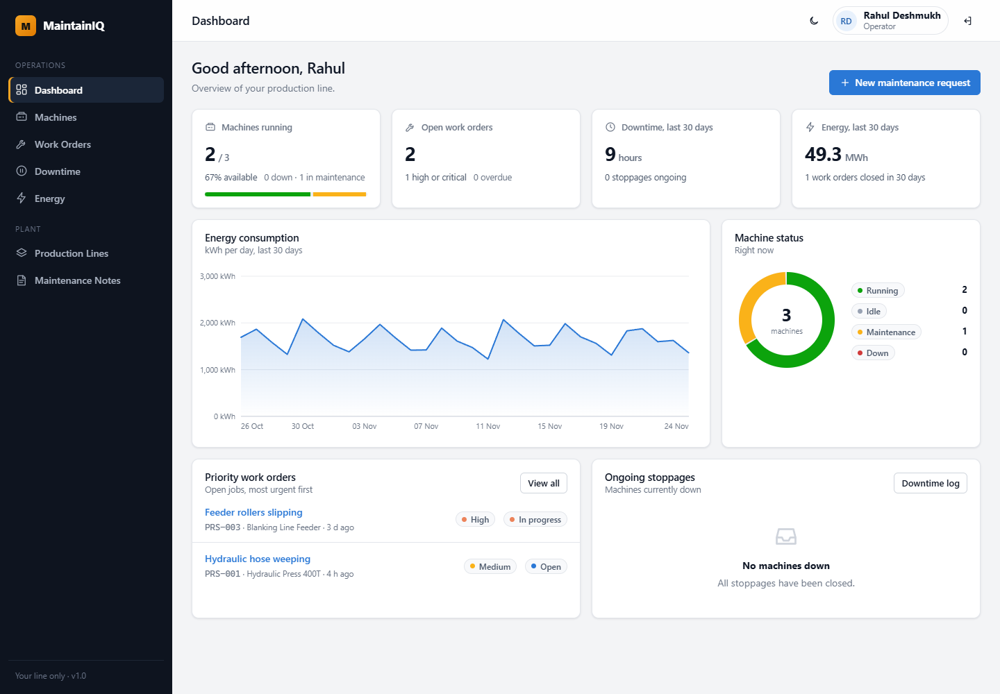 Operator (one line only) | 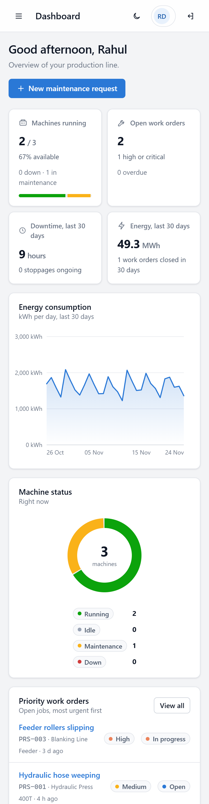 Mobile |

Screenshots are produced from the running app by `scripts/screenshots.js` (headless Chrome).

## Deployment

Planned: **Render** (free Node web service, HTTPS) for the Express app, which also serves the frontend, so there's one origin and no CORS configuration. Render does not offer MySQL, so the database will be on a managed MySQL provider with TLS (`DB_SSL=true`). [`render.yaml`](render.yaml) describes the service; secrets are entered in the Render dashboard. The health check is `/api/health`, which also pings the database.

First deploy: set `ALLOW_DB_RESET=true` once to run `npm run db:setup` against the empty hosted database, then remove it.

## Future improvements

- Refresh tokens in an httpOnly cookie instead of `localStorage`
- Pagination on the downtime and energy lists
- Database migrations (instead of the drop-and-recreate setup script)
- Attachments (photos) on work orders
- Browser end-to-end tests (Playwright)

## How this was built

Written with an AI coding assistant (Claude Code) and reviewed, run and tested locally. Every number in this README (tests, coverage, Postman results) comes from an actual run.
