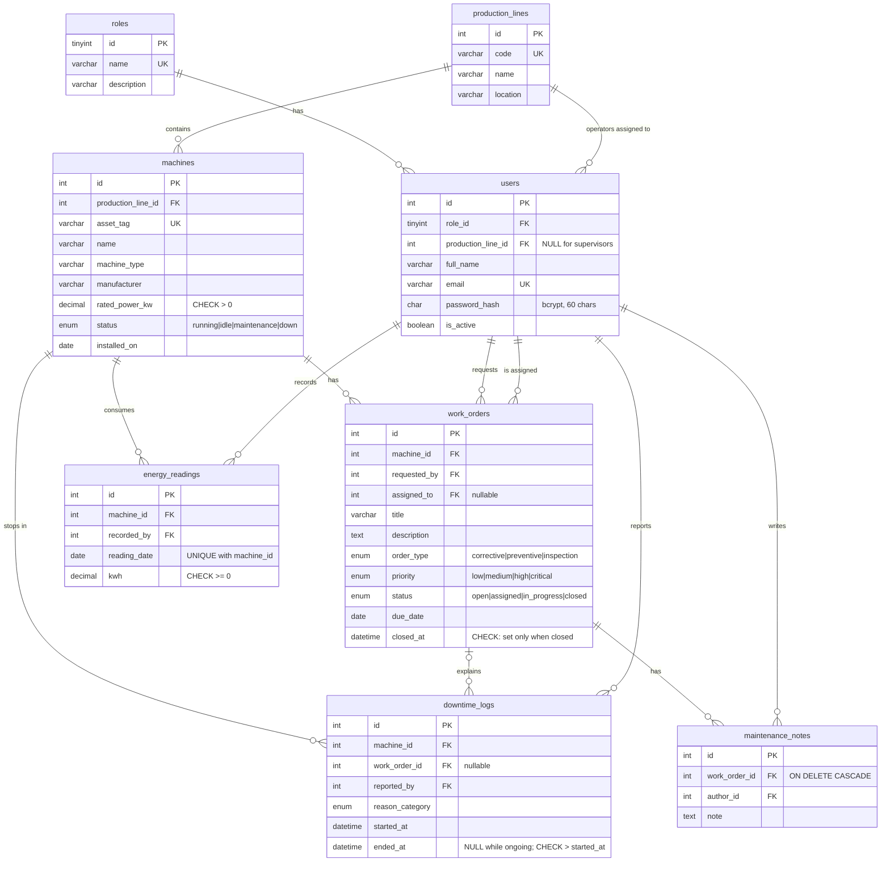

# Database design

MySQL 8, InnoDB, eight tables in third normal form. Source of truth: [`db/schema.sql`](../db/schema.sql). Demo data: [`db/seed.sql`](../db/seed.sql).

## ER diagram



Every table also has `created_at` and `updated_at` (`ON UPDATE CURRENT_TIMESTAMP`).

## Why it is normalised this way

| Decision | Reason |
|---|---|
| `roles` is its own table, `users.role_id` references it | Role names are stored once; adding a role is an INSERT, not a schema change |
| Machines reference `production_lines`; line name is not copied into machines | Renaming a line is one UPDATE and can never leave stale copies (no update anomaly) |
| Operators link to a line via `users.production_line_id` | The same column drives "operators only see their own line" in every query |
| Downtime **duration is not stored** | It is calculated with `TIMESTAMPDIFF(started_at, COALESCE(ended_at, NOW()))`, so it can never disagree with the times |
| Notes are a separate table, not a text column on work orders | A work order has many notes, each with its own author and time (1-to-many) |
| Users are deactivated (`is_active`), never deleted | Work orders, downtime and readings keep a valid author |

## Constraints

| Kind | Where |
|---|---|
| Primary keys | `id` on every table |
| Unique | `roles.name`, `production_lines.code`, `users.email`, `machines.asset_tag`, `energy_readings(machine_id, reading_date)` |
| Foreign keys | 13, listed in the diagram. `ON DELETE RESTRICT` protects history (you cannot delete a machine with work orders); `CASCADE` removes notes with their work order; `SET NULL` for optional links |
| CHECK | `rated_power_kw > 0`, `kwh >= 0`, `ended_at > started_at`, and `closed_at` is set **only** when `status = 'closed'` |

The API turns constraint errors into clean responses: duplicate key → 409, missing foreign key → 400, row still referenced → 409.

## Indexes

| Index | Used by |
|---|---|
| `machines(production_line_id, status)` | Operator scoping, status filters, dashboard counts |
| `work_orders(status, priority)` | Work order list ordering and KPI counts |
| `work_orders(machine_id)` | Machine detail and the machines ↔ work orders report |
| `work_orders(assigned_to, status)` | Workload report, "only mine" filter |
| `downtime_logs(machine_id, started_at)` | Per-machine downtime and the above-average subquery |
| `downtime_logs(started_at)` | Monthly downtime report, date filters |
| `energy_readings(reading_date)` | Daily trend and monthly energy report |
| `maintenance_notes(work_order_id, created_at)` | Notes timeline on a work order |

Check a plan yourself, for example:

```sql
EXPLAIN SELECT * FROM downtime_logs WHERE started_at >= '2026-06-01';
```

## Report queries

All in [`src/routes/reports.js`](../src/routes/reports.js), each run live against the current data:

| Report | SQL features |
|---|---|
| Machines and their work orders | `LEFT JOIN`, `GROUP BY`, conditional `SUM(status <> 'closed')` |
| Monthly downtime | `GROUP BY DATE_FORMAT(started_at, '%Y-%m')`, `TIMESTAMPDIFF`, `AVG` |
| Monthly energy per production line | 3-table `JOIN`, `GROUP BY` line and month |
| Machines with above-average downtime | Derived-table subquery for per-machine totals, `AVG` over it, `HAVING` |
| Maintenance workload | `LEFT JOIN` users → work orders, `CASE` inside `AVG` for time-to-close |
| Downtime by cause | `GROUP BY reason_category` |

## Seed data

`npm run db:setup` loads: 2 roles, 4 production lines, 6 users, 12 machines, 16 work orders, 97 downtime events (one still ongoing), 2,160 energy readings (180 days × 12 machines) and 11 notes. Dates are relative to the day you run it, so the dashboard always shows recent activity. All names and companies are fictional.
